## Problem Definition

Applying linear regression models that model the relationship between multiple
independent variables $x_1 \dots x_d$ and dependent variable $y$ using a linear
hypothesis, given $\{X, y\}$.

$$
\hat{y} = \Phi(X)^T w\tag{1}\label{eq:hypothesis}
$$

$\Phi$ is the design matrix of basis functions.

## Dataset

First, load the dataset as a data frame for processing. The loading code is
adapted from the scikit-learn sample.[^boston]

[^boston]: scikit-learn, `sklearn.datasets.load_boston`.
    <https://scikit-learn.org/1.1/modules/generated/sklearn.datasets.load_boston.html>

```python
def __init__(self, url: str, columns: Optional[list] = None):
  '''
  boston dataset loading code derived from:
  https://scikit-learn.org/1.1/modules/generated/sklearn.datasets.load_boston.html
  '''
  raw_df = pd.read_csv(url, sep=r"\s+", skiprows=22, header=None)
  data = np.hstack([raw_df.values[::2, :], raw_df.values[1::2, :2]])
  target = raw_df.values[1::2, 2]
  self.df = pd.DataFrame(np.column_stack([data, target]), columns=columns)
```

## Part 1: Polynomial Basis Function

To solve the linear regression with basis function, the operations are broken
down into two steps. First is to generate $\phi$ using polynomial basis, with
monomials of a single variable only and no cross-terms.

$$
\phi(x) = \left[1,\; x_1, x_1^2, \dots, x_1^M,\; x_2, x_2^2, \dots, x_d^M\right]
\tag{2}\label{eq:basis}
$$

Note: I have introduced 1 in the design matrix as the bias column, so $w_0$ is
the intercept.

Step 2 is to compute the weight for each feature by least squares, solved with
the pseudo-inverse.

$$
w^{*} = \left(\Phi\Phi^T\right)^{-1}\Phi y = \left(\Phi^T\right)^{-} y
\tag{3}\label{eq:weights}
$$

```python
# Implementation for computing design matrix
N, d = X.shape
cols = [np.ones(N)] + [X[:, j]**k for j in range(d) for k in range(1, self.degree + 1)]
return np.column_stack(cols)

# Computing the model weight
Phi = self.design_matrix(X)
self.w = np.linalg.pinv(Phi) @ y

# Predict
return self.design_matrix(X) @ self.w

# Compute Metric
return root_mean_squared_error(y, self.predict(X))
```


### a) demo polynomial regression

```python
# Train Test Split Implementation
self.X_train, self.X_test, self.y_train, self.y_test = train_test_split(
                X, y, train_size=train_size, shuffle=shuffle)

# Fit the model with polynomial degree 1-7
degrees = list(range(1, 8))
train_rms, test_rms = [], []
for degree in degrees:
    model = PolynomialBasis(degree).fit(X_train, y_train)
    train_rms.append(model.evaluate(X_train, y_train))
    test_rms.append(model.evaluate(X_test, y_test))
    print(f"degree {degree}: train RMS = {train_rms[-1]:.4f}, "
          f"test RMS = {test_rms[-1]:.4e}")
```

| Degree | Train RMS ($1000s) | Test RMS ($1000s) |
|:---:|---:|---:|
| 1 | 2.037 | 36.44 |
| 2 | 1.578 | 1,097.19 |
| 3 | 1.449 | 48,672.83 |
| 4 | 1.282 | 29,316,003.22 |
| 5 | 1.282 | 345,791,732.62 |
| 6 | 1.510 | 6,331,452.42 |
| 7 | 1.602 | 988,143.02 |

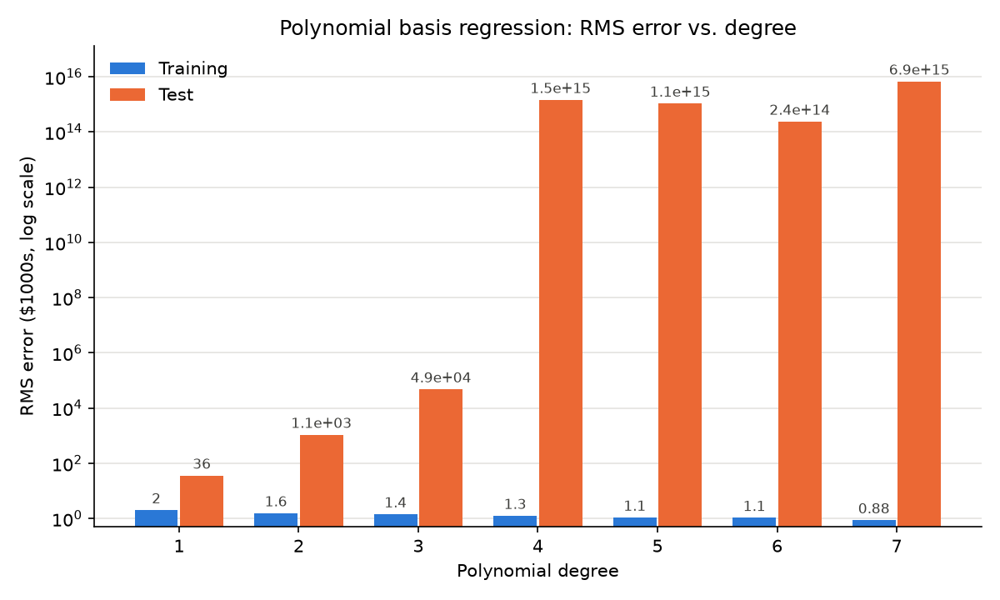

#### Discussion

The model fits the training data well but the test RMS is orders
of magnitude larger, growing with degree up to degree 5.

The input data is not normalized, so the high powers explode. The fitting using
higher order polynomials does not provide meaning prediction on the test dataset.

### b) Normalized degree 1 polynomial basis fitting


```python
# Normalizing the dataset over all 506 samples
scaler = MinMaxScaler().fit(X_all)
X_train_norm, X_test_norm = scaler.transform(X_train), scaler.transform(X_test)

# Fitting the regression model
model = PolynomialBasis(degree=1).fit(X_train_norm, y_train)
```

| Weight | Feature | Description | Normalized |
|:---:|:---|:---|---:|
| bias | — | intercept | 1.0792 |
| $w_0$ | CRIM | per capita crime rate by town | −307.4751 |
| $w_1$ | ZN | proportion of residential land zoned for lots over 25,000 sq.ft. | 0.5382 |
| $w_2$ | INDUS | proportion of non-retail business acres per town | −4.6043 |
| $w_3$ | CHAS | Charles River dummy variable (= 1 if tract bounds river; 0 otherwise) | 0.0000 |
| $w_4$ | NOX | nitric oxides concentration (parts per 10 million) | 10.4565 |
| $\mathbf{w_5}$ | **RM** | average number of rooms per dwelling | **44.8362** |
| $w_6$ | AGE | proportion of owner-occupied units built prior to 1940 | −7.6939 |
| $\mathbf{w_7}$ | **DIS** | weighted distances to five Boston employment centres | **0.0839** |
| $w_8$ | RAD | index of accessibility to radial highways | −3.2178 |
| $w_9$ | TAX | full-value property-tax rate per \$10,000 | −3.9981 |
| $w_{10}$ | PTRATIO | pupil-teacher ratio by town | 1.4528 |
| $w_{11}$ | B | $1000(B_k - 0.63)^2$ where $B_k$ is the proportion of blacks by town | 2.6353 |
| $w_{12}$ | LSTAT | % lower status of the population | 0.9506 |

The two features of interest are highlighted. The normalization constants are
taken from the whole dataset so that both splits map into $[0, 1]$, and the RMS
is identical before and after normalizing, confirming the transform does not
change the fit.

RM (feature #6, average number of rooms per dwelling) has a weight of 44.8362,
and DIS (feature #8, weighted distance to five Boston employment centres) a
weight of 0.0839, the smallest of any feature apart from CHAS. CHAS is exactly
0.0000 because it is constant over the 100 training samples, so it carries no
information for the fit.

### c) 1D Regression visualization

```python
# Input filter Feature #2 only
feature = 2
name = COLUMNS[feature]
x_train, x_test = X_train[:, [feature]], X_test[:, [feature]]

# Normalizing over all 506 samples
scaler_1d = MinMaxScaler().fit(X_all[:, [feature]])
x_train_norm = scaler_1d.transform(x_train)
x_test_norm = scaler_1d.transform(x_test)

# Polynomial Fitting
for degree in degrees:
    model = PolynomialBasis(degree).fit(x_train_norm, y_train)
    train_rms_1d = model.evaluate(x_train_norm, y_train)
    test_rms_1d = model.evaluate(x_test_norm, y_test)
```

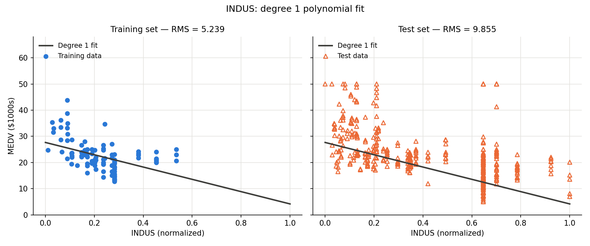

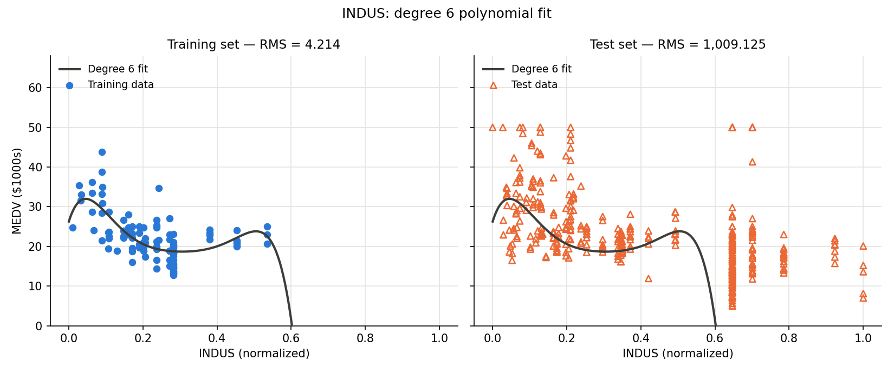

As shown in the result, the first 100 samples carry only limited information
about the dataset. A low-order polynomial captures the broad trend and gives a
reasonable result (degree 1 test RMS 9.86), but a higher-order one overfits
those 100 samples: degree 6 drives the training RMS down to 4.21 while
diverging outside the range the training data covers, pushing the test RMS to
1,009.13.

### d) L2-regularization  degree 8 regression

Ridge regression is least squares with an L2 penalty $\lambda\|w\|^2$ on the
weights, which gives

$$
w^{*} = \left(\Phi\Phi^T + \lambda I\right)^{-1}\Phi y
\tag{4}\label{eq:ridge}
$$

The penalty shrinks the weights toward zero, so $\lambda$ transform overfitting
into underfitting. A large $\lambda$ usually flattens the fit.
The implementation for ridge regression are

```python
Phi = self.design_matrix(X)
A = Phi.T @ Phi + np.diag(lam)
self.w = np.linalg.pinv(A) @ (Phi.T @ y)
```

Training RMS cannot be used to choose $\lambda$, since it always favours the
smallest penalty, and the test set must stay untouched for the final
evaluation. Instead, $\lambda$ is chosen by 10-fold cross-validation on the 100
training samples.

The samples are shuffled once and split into 10 folds of 10. For each
$\lambda$, the model is fitted on 9 folds (90 samples) and its RMS is measured
on the held-out fold. This repeats until every fold has been held out once, and
the 10 validation RMS values are averaged. The same folds are used for every
$\lambda$, and the one with the lowest mean validation RMS is selected. The
final weights are then fitted with that $\lambda$ on all 100 training samples.


```python
def regularized_fit(self, X: np.ndarray, y: np.ndarray, lam: np.ndarray,
                cross_validation: bool = False, folds=None):
if cross_validation:
    if folds is None:
        folds = KFold(n_splits=10, shuffle=True, random_state=0)
    self.cv_train_rms, self.cv_val_rms = self.cross_validate(X, y, lam, folds)

self._ridge_solve(X, y, lam)
return self

def cross_validate(self, X: np.ndarray, y: np.ndarray, lam: np.ndarray, folds):
    train_rms, val_rms = [], []
    for train_idx, val_idx in folds.split(X):
        self._ridge_solve(X[train_idx], y[train_idx], lam)
        train_rms.append(self.evaluate(X[train_idx], y[train_idx]))
        val_rms.append(self.evaluate(X[val_idx], y[val_idx]))
    return float(np.mean(train_rms)), float(np.mean(val_rms))
```

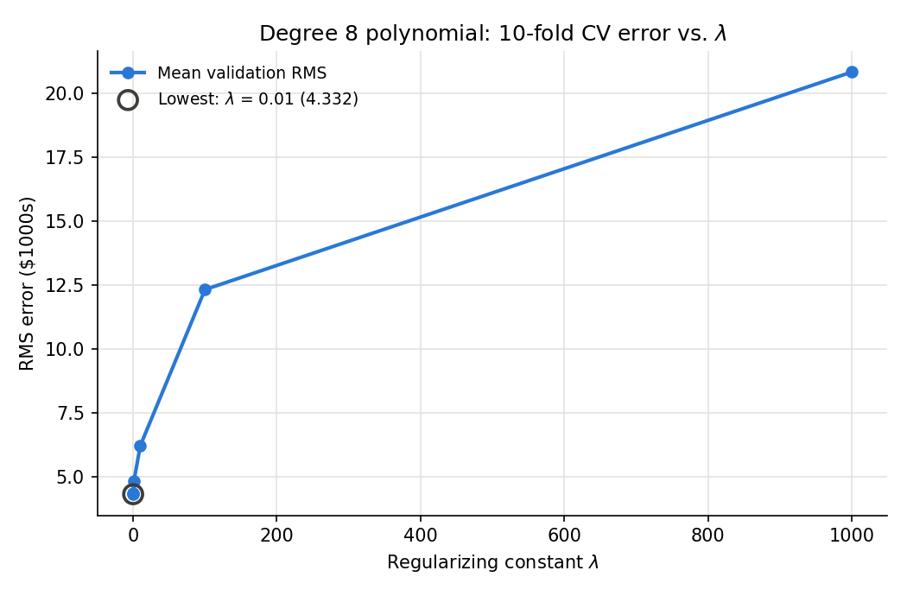

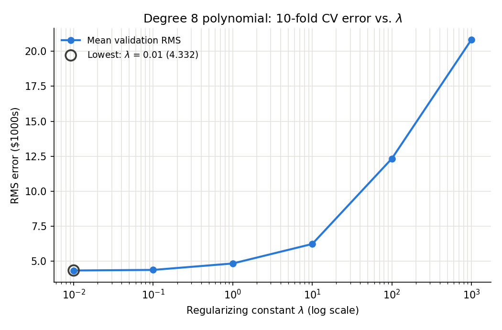

Mean RMS over the 10 folds for each $\lambda$, including the unregularized
baseline $\lambda = 0$:

| $\lambda$ | Mean train RMS ($1000s) | Mean validation RMS ($1000s) |
|:---:|---:|---:|
| 0 | 3.892 | 4.497 |
| **0.01** | **4.278** | **4.332** |
| 0.1 | 4.373 | 4.373 |
| 1 | 4.911 | 4.833 |
| 10 | 6.452 | 6.229 |
| 100 | 12.559 | 12.329 |
| 1000 | 20.947 | 20.830 |

From the cross-validation, I would choose $\lambda = 0.01$ as the regularizing
constant, since it gives the smallest mean validation RMS (4.332) for the
degree 8 polynomial basis.

However, the test set tells a different story. Even at $\lambda = 0.01$ the
fit still overfits: almost half of the test samples have INDUS values beyond
the training range, where the degree 8 curve dives. A larger
$\lambda$ keeps the curve flatter there, so the test RMS is lowest at
$\lambda = 10$.

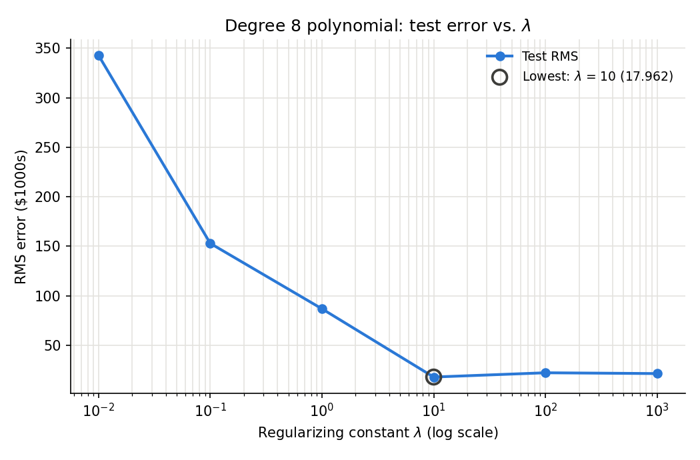

| $\lambda$ | Train RMS ($1000s) | Test RMS ($1000s) |
|:---:|---:|---:|
| 0.01 | 4.292 | 342.682 |
| 0.1 | 4.373 | 152.907 |
| 1 | 4.882 | 86.858 |
| **10** | **6.351** | **17.962** |
| 100 | 12.094 | 22.269 |
| 1000 | 20.741 | 21.464 |

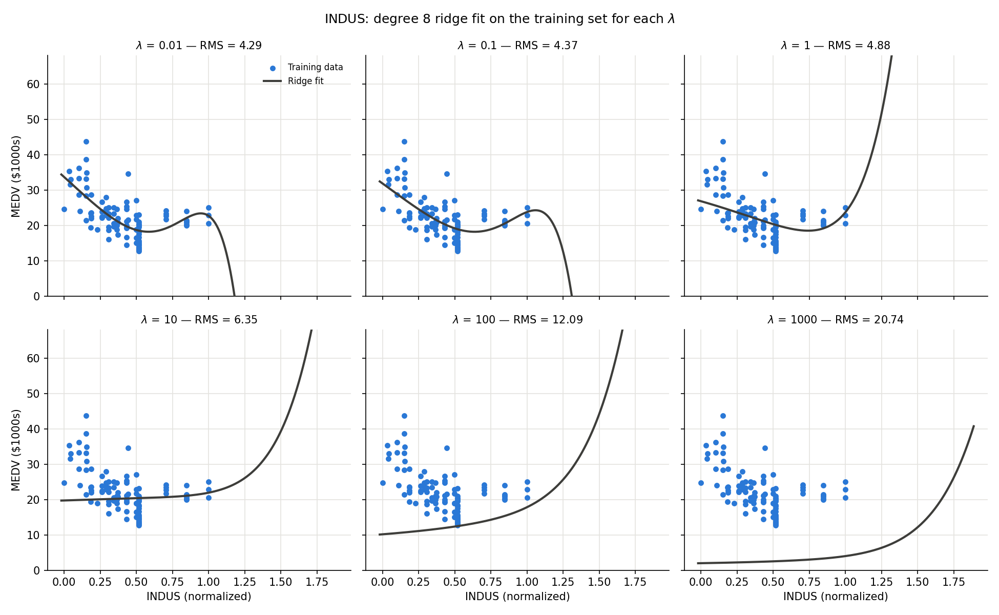

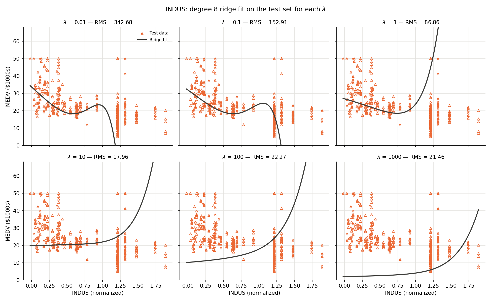

Cross-validation can only judge the model where the training data lies, so it
cannot see the extrapolation error that dominates the test RMS.

## Part 2: Gaussian Basis Function

### e) Fitting through gaussian regression

According to textbook the function used for guassian basis function is:

$$
\varphi_k(\mathbf{x}, \mathbf{c}_k, a) = \exp\left(a\|\mathbf{x} - \mathbf{c}_k\|^2\right)
$$

$a$ sets the width and must be negative. A more negative $a$ gives a narrower
bump and less overlap between neighbouring basis functions. $K$ is the number
of basis functions, selected by taking a random permutation of the 100 training
points and using the first $K$ of them as the centres $\mathbf{c}_k$, which
gives $1 + K$ weights once the bias is included.

The figure below shows the four widths used in the experiment. When $|a|$ is
small the bumps are wide and almost identical, so the coverage is a single
broad hump centred in the middle of the data; when $|a|$ is large each bump is
narrow and the coverage breaks into separate spikes with gaps between them.

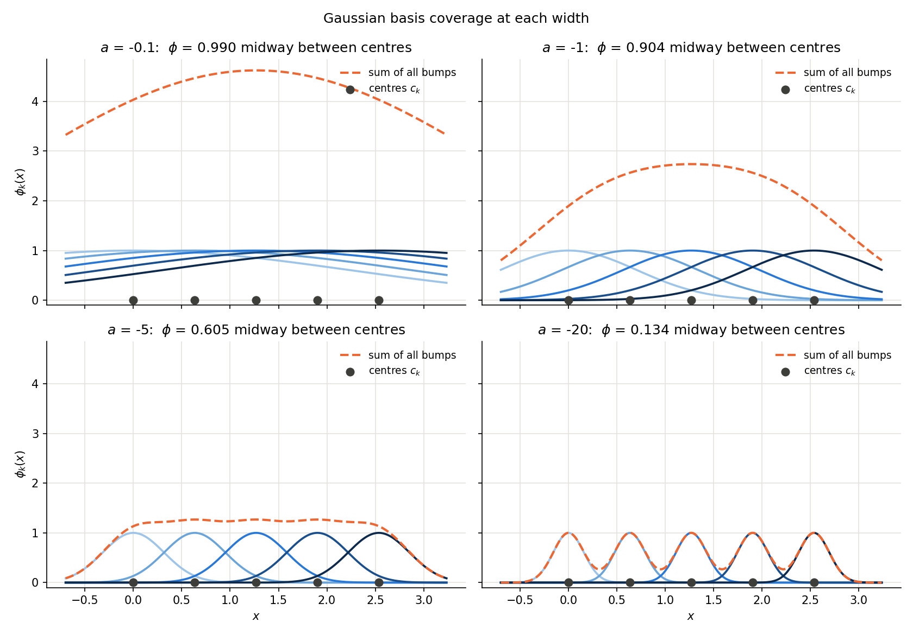

```python
def design_matrix(self, X: np.ndarray) -> np.ndarray:
  '''
  X: (N, d) -> Phi: (N, 1 + K), columns [1, phi_1(x), ..., phi_K(x)]
  >>> model = GaussianBasis(np.array([[0., 0.], [1., 1.]]), n_centers=2)
  >>> model.centers
  array([[0., 0.],
          [1., 1.]])
  >>> Phi = model.design_matrix(np.array([[0., 0.]]))
  >>> Phi.shape
  (1, 3)
  >>> Phi.round(4)
  array([[1.    , 1.    , 0.1353]])
  '''
  # Prepare Data
  X = np.atleast_2d(np.asarray(X))[:, None, :]
  centers = self.centers[None, :, :]
  # Compute the basis function
  sq_distances = ((X - centers) ** 2).sum(axis=-1)
  Phi_basis = np.exp(self.a * sq_distances)
  # Append the bias term
  bias_column = np.ones((X.shape[0], 1))
  Phi = np.hstack([bias_column, Phi_basis])
  return Phi
```

Each $K$ in $\{5, 15, 25, \dots, 95\}$ is fitted at each of the four widths,
with no regularization. The best width for each $K$ is shown in bold.

**Training RMS ($1000s)**

| $K$ | $a=-0.1$ | $a=-1$ | $a=-5$ | $a=-20$ |
|:---:|---:|---:|---:|---:|
| 5 | **3.4171** | 3.5334 | 4.1490 | 4.8687 |
| 15 | **2.0234** | 2.1641 | 3.1895 | 4.7499 |
| 25 | **1.4434** | 1.6132 | 2.6441 | 4.0264 |
| 35 | **1.3793** | 1.4559 | 1.9860 | 2.6588 |
| 45 | **1.2103** | 1.2479 | 1.3506 | 2.2670 |
| 55 | 1.0930 | **1.0810** | 1.1639 | 1.6937 |
| 65 | **0.8861** | 0.9457 | 1.1135 | 1.5512 |
| 75 | **0.7749** | 0.8654 | 1.0016 | 1.3664 |
| 85 | **0.4924** | 0.6928 | 0.9439 | 1.1462 |
| 95 | 0.2066 | **0.2005** | 0.2897 | 0.2946 |

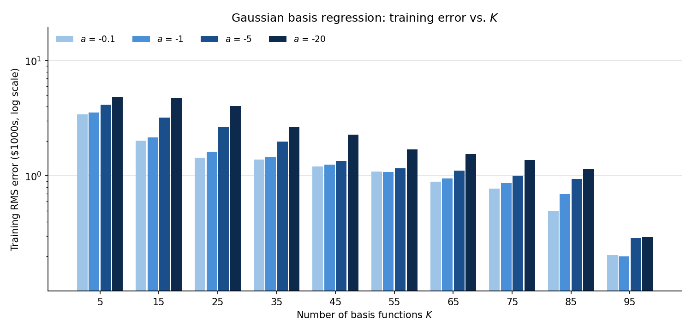

**Test RMS ($1000s)**

| $K$ | $a=-0.1$ | $a=-1$ | $a=-5$ | $a=-20$ |
|:---:|---:|---:|---:|---:|
| 5 | **7.14** | 10.26 | 9.90 | 9.81 |
| 15 | **6.68** | 11.90 | 10.04 | 9.80 |
| 25 | 14.98 | 11.42 | 10.30 | **9.78** |
| 35 | 13.57 | 9.55 | **8.82** | 9.62 |
| 45 | 20.59 | 12.87 | **8.66** | 9.68 |
| 55 | 29.20 | 16.29 | **8.80** | 9.83 |
| 65 | 102.04 | 19.14 | **8.76** | 9.85 |
| 75 | 97.86 | 15.26 | **8.70** | 9.86 |
| 85 | 349.86 | 10.33 | **8.61** | 9.93 |
| 95 | 631.97 | 59.37 | 10.15 | **9.68** |

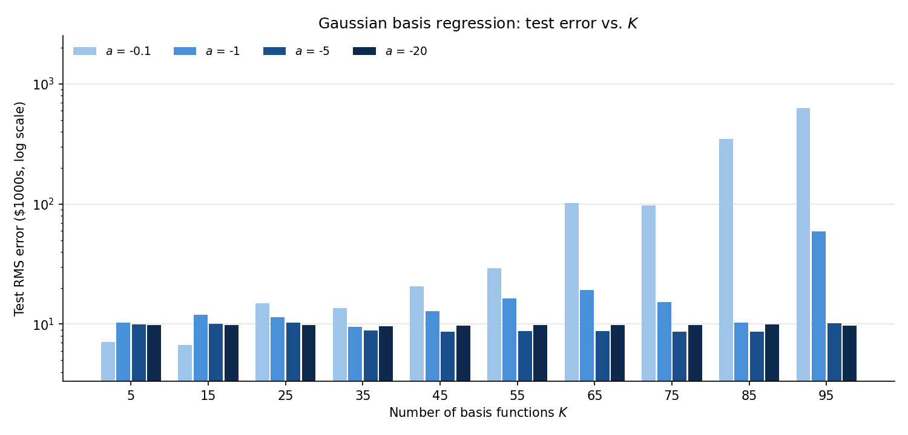

The more data points used as the centres of the basis, the more the model
overfits the training data, and the closer $a$ is to zero the better it fits
the training set.

The test data frame tell a different result. $a = -0.1$ has the
lowest training error at almost every $K$ but the highest test error beyond
$K = 25$, and at $K = 95$ all four widths reach a training RMS of about 0.2
while their test errors differ by a factor of 65.


### f) L2-regularized gaussian regression

The same basis is now fitted with $K = 90$ centres on all 13 features of the
first 100 points, using each $\lambda$ in $\{0, 0.01, 0.1, 1, 10, 100, 1000\}$
and the same four widths. $\lambda$ is chosen by 10-fold cross-validation over
the 100 training points. The best $\lambda$ for each width is shown in bold.

**Mean 10-fold validation RMS ($1000s)**

| $\lambda$ | $a=-0.1$ | $a=-1$ | $a=-5$ | $a=-20$ |
|:---:|---:|---:|---:|---:|
| 0 | 7.64 | 46.91 | 456.41 | 22,658.67 |
| 0.01 | **2.83** | **1.99** | 2.53 | 3.99 |
| 0.1 | 3.30 | 2.33 | **2.31** | **3.34** |
| 1 | 4.14 | 3.22 | 2.71 | 3.51 |
| 10 | 5.17 | 4.49 | 4.69 | 5.06 |
| 100 | 5.72 | 5.65 | 8.68 | 12.22 |
| 1000 | 6.23 | 7.91 | 16.16 | 20.87 |

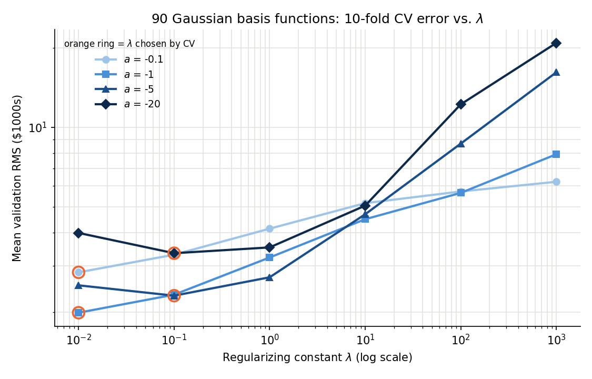

**Test RMS ($1000s)**

| $\lambda$ | $a=-0.1$ | $a=-1$ | $a=-5$ | $a=-20$ |
|:---:|---:|---:|---:|---:|
| 0 | 36.12 | 45.90 | **8.75** | 9.65 |
| 0.01 | **6.48** | 9.02 | 8.77 | 9.62 |
| 0.1 | 8.96 | **7.72** | 8.86 | **9.59** |
| 1 | 8.90 | 8.82 | 9.14 | 9.65 |
| 10 | 9.09 | 12.75 | 11.65 | 10.34 |
| 100 | 9.50 | 14.36 | 16.85 | 15.56 |
| 1000 | 10.26 | 15.94 | 21.31 | 22.76 |

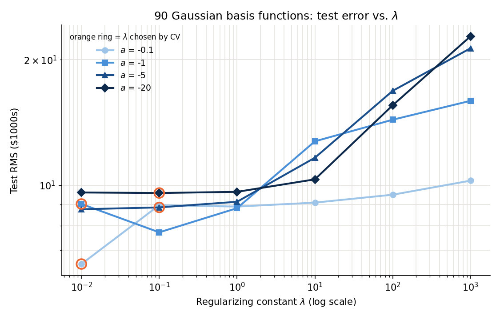

$\lambda = 0$ is left out of both plots because it has no position on a log
axis. It is by far the worst setting: with 91 weights fitted to 90 points in
each fold the unregularized system is underdetermined, and the validation error
grows from 7.64 at $a = -0.1$ to 22,658.67 at $a = -20$ as the bumps narrow and
the design matrix approaches the identity. Any $\lambda \geq 0.01$ removes this
entirely.

From the cross-validation results I would use $\lambda = 0.1$ as my
regularizing constant for the narrower bases ($a = -5$ and $a = -20$), and
$\lambda = 0.01$ for the wider ones ($a = -0.1$ and $a = -1$). The orange ring
on both plots marks that choice, so the second plot shows whether it was a good
one: it is close to the test optimum in every case except $a = -1$, where
cross-validation picks 0.01 but 0.1 would have given a lower test error.
