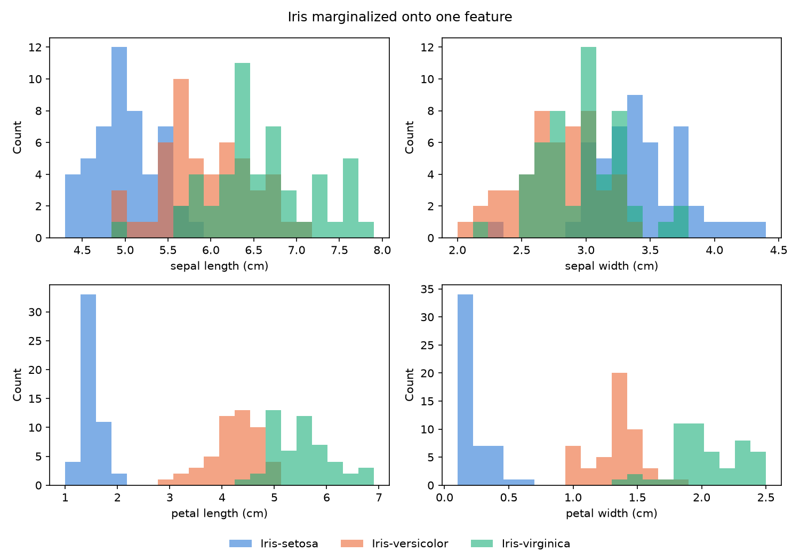
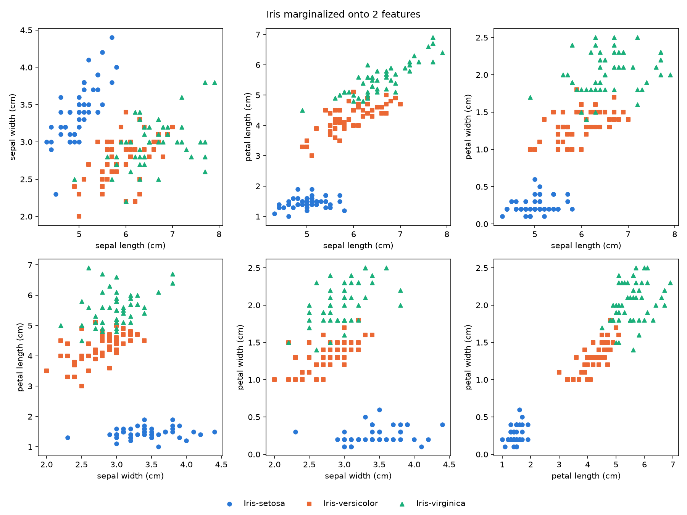
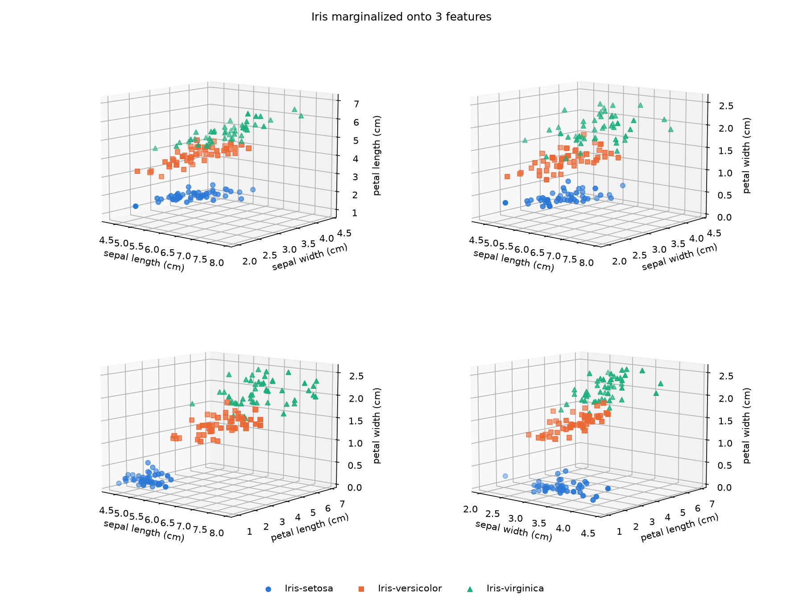
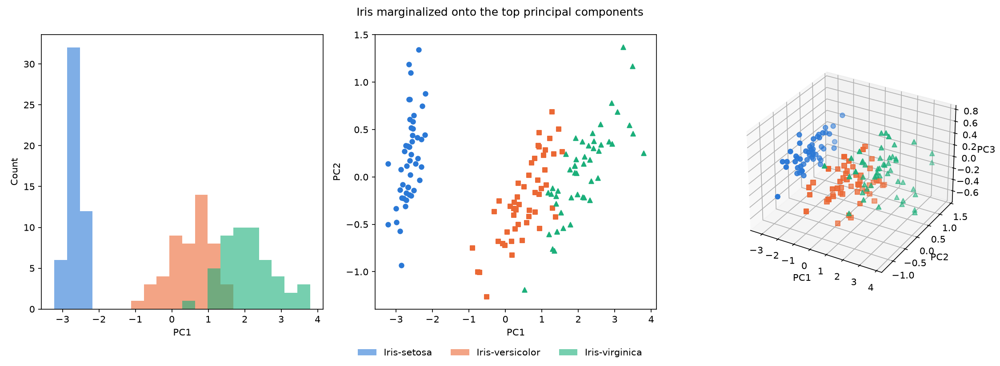
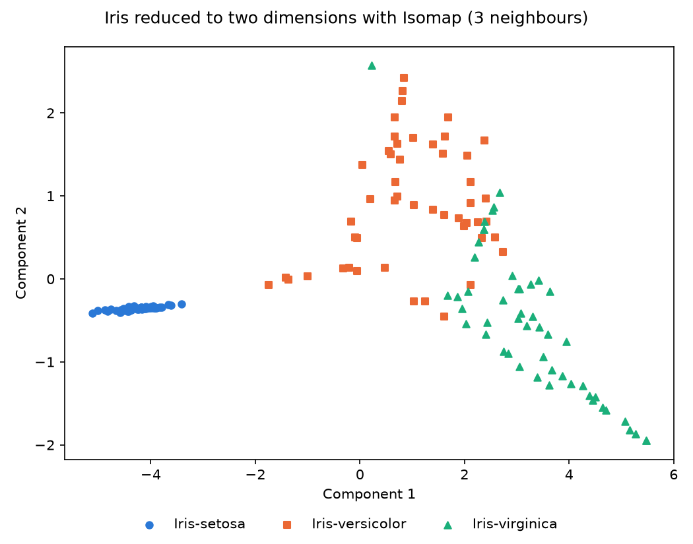
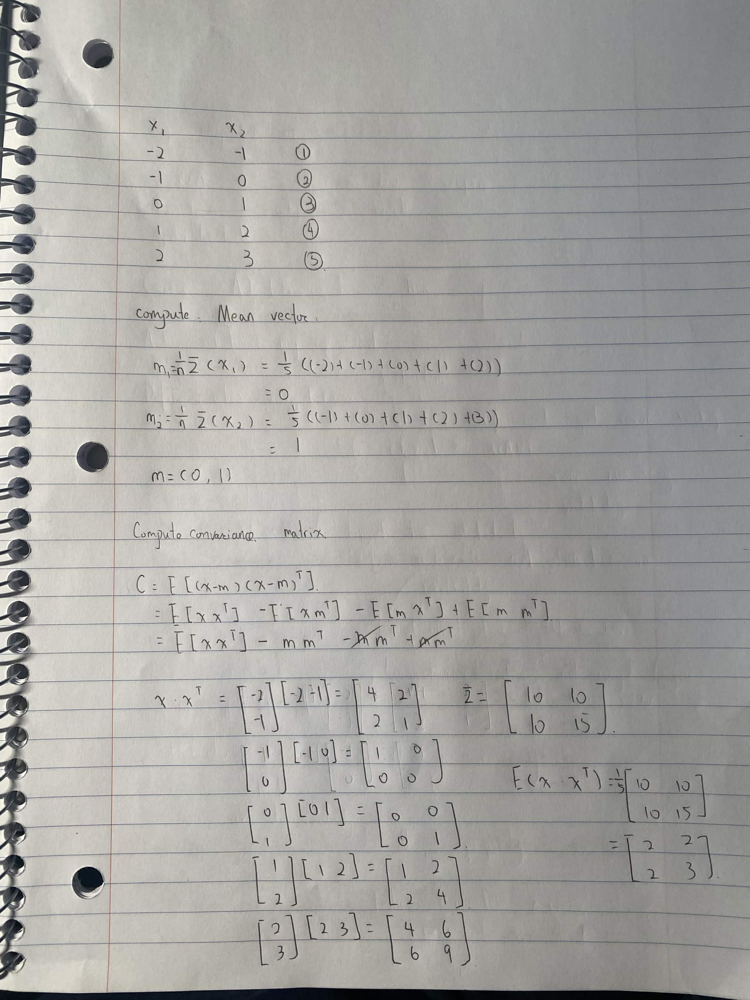
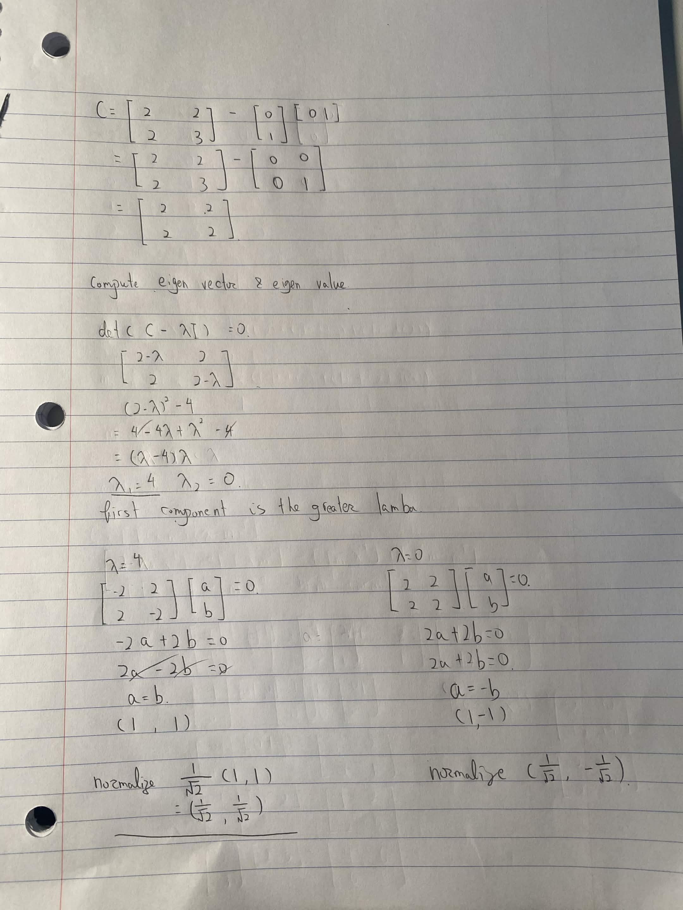
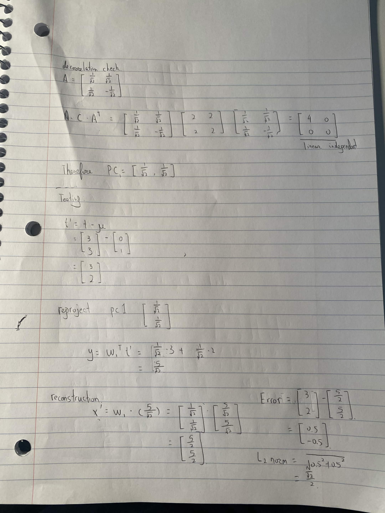
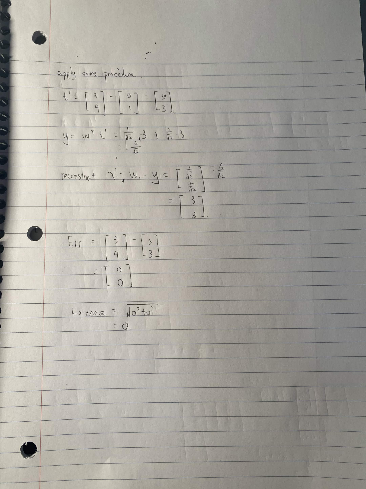

## Part I: Solve PCA by Hand

# Part 1: PCA by Hand

## Dataset

| Sample | $x_1$ | $x_2$ |
|:---:|:---:|:---:|
| 1 | $-2$ | $-1$ |
| 2 | $-1$ | $0$ |
| 3 | $0$ | $1$ |
| 4 | $1$ | $2$ |
| 5 | $2$ | $3$ |

---

## Step 1: Compute the Mean Vector

$$
m_1 = \frac{1}{n}\sum x_1 = \frac{1}{5}\big((-2) + (-1) + 0 + 1 + 2\big) = 0
$$

$$
m_2 = \frac{1}{n}\sum x_2 = \frac{1}{5}\big((-1) + 0 + 1 + 2 + 3\big) = 1
$$

$$
\mathbf{m} = \begin{bmatrix} 0 \\ 1 \end{bmatrix}
$$

---

## Step 2: Compute the Covariance Matrix

$$
\begin{aligned}
C_x &= E\left[(\mathbf{x}-\mathbf{m})(\mathbf{x}-\mathbf{m})^T\right] \\
&= E\left[\mathbf{x}\mathbf{x}^T\right] - E\left[\mathbf{x}\mathbf{m}^T\right] - E\left[\mathbf{m}\mathbf{x}^T\right] + E\left[\mathbf{m}\mathbf{m}^T\right] \\
&= E\left[\mathbf{x}\mathbf{x}^T\right] - \mathbf{m}\mathbf{m}^T - \mathbf{m}\mathbf{m}^T + \mathbf{m}\mathbf{m}^T \\
&= E\left[\mathbf{x}\mathbf{x}^T\right] - \mathbf{m}\mathbf{m}^T
\end{aligned}
$$

### Outer products $\mathbf{x}_i\mathbf{x}_i^T$

$$
\begin{bmatrix} -2 \\ -1 \end{bmatrix}\begin{bmatrix} -2 & -1 \end{bmatrix} = \begin{bmatrix} 4 & 2 \\ 2 & 1 \end{bmatrix}
\qquad
\begin{bmatrix} -1 \\ 0 \end{bmatrix}\begin{bmatrix} -1 & 0 \end{bmatrix} = \begin{bmatrix} 1 & 0 \\ 0 & 0 \end{bmatrix}
$$

$$
\begin{bmatrix} 0 \\ 1 \end{bmatrix}\begin{bmatrix} 0 & 1 \end{bmatrix} = \begin{bmatrix} 0 & 0 \\ 0 & 1 \end{bmatrix}
\qquad
\begin{bmatrix} 1 \\ 2 \end{bmatrix}\begin{bmatrix} 1 & 2 \end{bmatrix} = \begin{bmatrix} 1 & 2 \\ 2 & 4 \end{bmatrix}
$$

$$
\begin{bmatrix} 2 \\ 3 \end{bmatrix}\begin{bmatrix} 2 & 3 \end{bmatrix} = \begin{bmatrix} 4 & 6 \\ 6 & 9 \end{bmatrix}
$$

$$
\sum_i \mathbf{x}_i\mathbf{x}_i^T = \begin{bmatrix} 10 & 10 \\ 10 & 15 \end{bmatrix}
\qquad\Rightarrow\qquad
E\left[\mathbf{x}\mathbf{x}^T\right] = \frac{1}{5}\begin{bmatrix} 10 & 10 \\ 10 & 15 \end{bmatrix} = \begin{bmatrix} 2 & 2 \\ 2 & 3 \end{bmatrix}
$$

### Subtract $\mathbf{m}\mathbf{m}^T$

$$
\begin{aligned}
C_x &= \begin{bmatrix} 2 & 2 \\ 2 & 3 \end{bmatrix} - \begin{bmatrix} 0 \\ 1 \end{bmatrix}\begin{bmatrix} 0 & 1 \end{bmatrix} \\
&= \begin{bmatrix} 2 & 2 \\ 2 & 3 \end{bmatrix} - \begin{bmatrix} 0 & 0 \\ 0 & 1 \end{bmatrix} \\
&= \begin{bmatrix} 2 & 2 \\ 2 & 2 \end{bmatrix}
\end{aligned}
$$

---

## Step 3: Compute the Eigenvalues and Eigenvectors

$$
\det(C_x - \lambda I) = 0
\qquad
\begin{vmatrix} 2-\lambda & 2 \\ 2 & 2-\lambda \end{vmatrix} = 0
$$

$$
\begin{aligned}
(2-\lambda)^2 - 4 &= 4 - 4\lambda + \lambda^2 - 4 \\
&= \lambda(\lambda - 4) = 0
\end{aligned}
$$

$$
\boxed{\lambda_1 = 4, \quad \lambda_2 = 0}
$$

The first principal component corresponds to the larger eigenvalue, $\lambda_1 = 4$.

### Eigenvector for $\lambda_1 = 4$

$$
\begin{bmatrix} -2 & 2 \\ 2 & -2 \end{bmatrix}\begin{bmatrix} a \\ b \end{bmatrix} = \mathbf{0}
\quad\Rightarrow\quad
-2a + 2b = 0
\quad\Rightarrow\quad
a = b
\quad\Rightarrow\quad
(1,\ 1)
$$

The second row ($2a - 2b = 0$) is redundant.

Normalize:

$$
\mathbf{e}_1 = \frac{1}{\sqrt{2}}(1,\ 1) = \left(\frac{1}{\sqrt{2}},\ \frac{1}{\sqrt{2}}\right)
$$

### Eigenvector for $\lambda_2 = 0$

$$
\begin{bmatrix} 2 & 2 \\ 2 & 2 \end{bmatrix}\begin{bmatrix} a \\ b \end{bmatrix} = \mathbf{0}
\quad\Rightarrow\quad
2a + 2b = 0
\quad\Rightarrow\quad
a = -b
\quad\Rightarrow\quad
(1,\ -1)
$$

Normalize:

$$
\mathbf{e}_2 = \left(\frac{1}{\sqrt{2}},\ -\frac{1}{\sqrt{2}}\right)
$$

---

## Step 4: Decorrelation Check

$$
A = \begin{bmatrix} \mathbf{e}_1^T \\ \mathbf{e}_2^T \end{bmatrix} = \begin{bmatrix} \frac{1}{\sqrt{2}} & \frac{1}{\sqrt{2}} \\[4pt] \frac{1}{\sqrt{2}} & -\frac{1}{\sqrt{2}} \end{bmatrix}
$$

$$
C_y = A\,C_x\,A^T =
\begin{bmatrix} \frac{1}{\sqrt{2}} & \frac{1}{\sqrt{2}} \\[4pt] \frac{1}{\sqrt{2}} & -\frac{1}{\sqrt{2}} \end{bmatrix}
\begin{bmatrix} 2 & 2 \\ 2 & 2 \end{bmatrix}
\begin{bmatrix} \frac{1}{\sqrt{2}} & \frac{1}{\sqrt{2}} \\[4pt] \frac{1}{\sqrt{2}} & -\frac{1}{\sqrt{2}} \end{bmatrix}
= \begin{bmatrix} 4 & 0 \\ 0 & 0 \end{bmatrix}
$$

$C_y$ is diagonal, so the transformed components are uncorrelated.

---

## Q1: First Principal Component

$$
\boxed{PC_1 = \mathbf{w}_1 = \left(\frac{1}{\sqrt{2}},\ \frac{1}{\sqrt{2}}\right) \approx (0.707,\ 0.707)}
$$

Only the first principal component is kept, since $\lambda_2 = 0 \ll \lambda_1 = 4$. The 1-D PCA representation therefore captures all of the variance.

---

## Q2: Reconstruction Error of $(3, 3)$

**Subtract the mean:**

$$
\mathbf{t}' = \mathbf{t} - \boldsymbol{\mu} = \begin{bmatrix} 3 \\ 3 \end{bmatrix} - \begin{bmatrix} 0 \\ 1 \end{bmatrix} = \begin{bmatrix} 3 \\ 2 \end{bmatrix}
$$

**Project onto $PC_1$:**

$$
y = \mathbf{w}_1^T\mathbf{t}' = \frac{1}{\sqrt{2}}\cdot 3 + \frac{1}{\sqrt{2}}\cdot 2 = \frac{5}{\sqrt{2}}
$$

**Reconstruct:**

$$
\mathbf{x}' = \mathbf{w}_1\, y = \begin{bmatrix} \frac{1}{\sqrt{2}} \\[4pt] \frac{1}{\sqrt{2}} \end{bmatrix}\cdot\frac{5}{\sqrt{2}} = \begin{bmatrix} \frac{5}{2} \\[4pt] \frac{5}{2} \end{bmatrix}
$$

**Error:**

$$
\mathbf{t}' - \mathbf{x}' = \begin{bmatrix} 3 \\ 2 \end{bmatrix} - \begin{bmatrix} \frac{5}{2} \\[4pt] \frac{5}{2} \end{bmatrix} = \begin{bmatrix} 0.5 \\ -0.5 \end{bmatrix}
$$

$$
\|\mathbf{t}' - \mathbf{x}'\|_2 = \sqrt{0.5^2 + (-0.5)^2} = \sqrt{0.5} = \frac{\sqrt{2}}{2}
$$

$$
\boxed{L_2 \text{ error} = \frac{\sqrt{2}}{2} \approx 0.707}
$$

---

## Q3: Reconstruction Error of $(3, 4)$

Apply the same procedure.

**Subtract the mean:**

$$
\mathbf{t}' = \begin{bmatrix} 3 \\ 4 \end{bmatrix} - \begin{bmatrix} 0 \\ 1 \end{bmatrix} = \begin{bmatrix} 3 \\ 3 \end{bmatrix}
$$

**Project onto $PC_1$:**

$$
y = \mathbf{w}_1^T\mathbf{t}' = \frac{1}{\sqrt{2}}\cdot 3 + \frac{1}{\sqrt{2}}\cdot 3 = \frac{6}{\sqrt{2}}
$$

**Reconstruct:**

$$
\mathbf{x}' = \mathbf{w}_1\, y = \begin{bmatrix} \frac{1}{\sqrt{2}} \\[4pt] \frac{1}{\sqrt{2}} \end{bmatrix}\cdot\frac{6}{\sqrt{2}} = \begin{bmatrix} 3 \\ 3 \end{bmatrix}
$$

**Error:**

$$
\mathbf{t}' - \mathbf{x}' = \begin{bmatrix} 3 \\ 3 \end{bmatrix} - \begin{bmatrix} 3 \\ 3 \end{bmatrix} = \begin{bmatrix} 0 \\ 0 \end{bmatrix}
$$

$$
\|\mathbf{t}' - \mathbf{x}'\|_2 = \sqrt{0^2 + 0^2} = 0
$$

$$
\boxed{L_2 \text{ error} = 0}
$$

The point $(3, 4)$ lies exactly on the line $x_2 = x_1 + 1$ spanned by $PC_1$ through the mean, so it is reconstructed perfectly.

The full handwritten solutions are in the [appendix](#appendix-handwritten-solutions).

## Part II: Data Visualization

We plot every combination of one, two and three features.







Setosa forms a compact cluster that is clearly separated from the other two species in any marginalization that includes petal length or petal width features. Versicolor and virginica form neighbouring clusters that overlap slightly at their boundary. The sepal features alone separate the classes poorly.

## Part III: PCA

Now we perform PCA using the `PCA` function from scikit-learn to find the top three principal axes of the dataset.

```python
pca = PCA(n_components=3).fit(X)
pca.transform(X)
```



The vectors that describe the PCA axes, from `pca.components_`, are:

| Axis | Sepal length | Sepal width | Petal length | Petal width |
|:---:|:---:|:---:|:---:|:---:|
| $PC_1$ | $0.362$ | $-0.082$ | $0.857$ | $0.359$ |
| $PC_2$ | $0.657$ | $0.730$ | $-0.176$ | $-0.075$ |
| $PC_3$ | $-0.581$ | $0.596$ | $0.073$ | $0.549$ |


## Part IV: Data Compression

The Frobenius norm is defined as the following

$$
\|X\|_F = \sqrt{\sum_{i,j} x_{ij}^2}
$$

For a centered data matrix $X$ with $n$ samples, the squared Frobenius norm is proportional to the total variance:

$$
\|X\|_F^2 = \sum_{i,j} x_{ij}^2 = (n-1)\sum_j \sigma_j^2
$$

The projection $Z_k = XV_k$ onto the top $k$ PCs has the same relationship, so the fraction of variance explained by those PCs is:

$$
\frac{\|Z_k\|_F^2}{\|X\|_F^2}
$$

The code below computes this fraction for the top 1, 2 and 3 PCs:

```python
total = np.linalg.norm(X - X.mean(axis=0)) ** 2
np.cumsum(np.sum(Z ** 2, axis=0)) / total
```

### Q1: Variance in 2-D Representation

Keeping the top two principal axes gives:

$$
\boxed{\frac{\|Z_2\|_F^2}{\|X\|_F^2} = \frac{665.60}{680.82} \approx 97.76\%}
$$

### Q2: PCs Required for 50% of the Variance

Only one PC is required, since $PC_1$ alone explains $92.46\%$ of the variance, which is above the $50\%$ threshold.

## Part V: Non-Linear Components

Now we reduce the dataset to two dimensions using the `Isomap` function from scikit-learn with 3 nearest neighbours.

```python
isomap = Isomap(n_neighbors=3, n_components=2)
Z_isomap = isomap.fit_transform(X)
```



### Comparison with PCA

PCA is preferable in this case. The data compressed by PCA follows a nearly linear trend, while the Isomap result is more scattered, with versicolor and virginica stretched into separate branches. Using the same variance explained metric from Part IV, the two methods give similar results, but Isomap compresses the data slightly worse than PCA, as shown in the table below. Note the distance metric are used differently for the two method.

| Method (2-D) | $\lVert Z_2 \rVert_F^2$ | Total | Variance explained |
|:---|:---:|:---:|:---:|
| PCA | $665.60$ | $680.82$ | $97.76\%$ |
| Isomap | $1745.00$ | $1813.44$ | $96.23\%$ |

Both totals are $\frac{1}{2n}\sum_{i,j} d_{ij}^2$. PCA uses the straight-line distance $d_{ij} = \|\mathbf{x}_i - \mathbf{x}_j\|_2$, while Isomap uses the geodesic distance, which is the shortest path between samples $i$ and $j$ through the 3-nearest-neighbour graph.

## Appendix: Handwritten Solutions









## Source Code

- [`main.py`](https://github.com/billylin609/billylin609.github.io/blob/main/src/content/coursework/syde572/assignment3/solns/main.py) runs Parts II to V.
- [`dataLoader.py`](https://github.com/billylin609/billylin609.github.io/blob/main/src/content/coursework/syde572/assignment3/solns/dataLoader.py) loads the Iris dataset.
