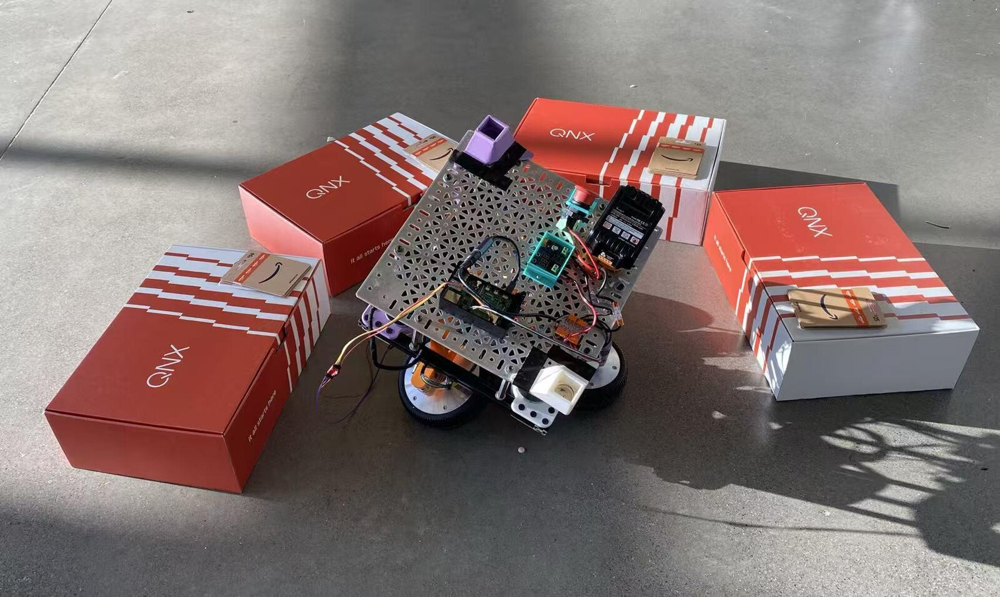
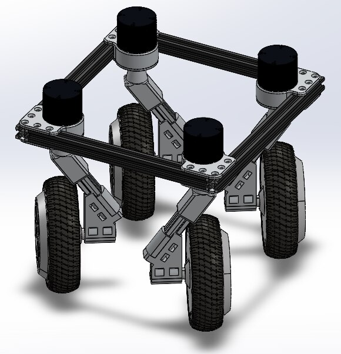

## What it is

A swerve drive built in 36 hours at [Hack the North 2025](https://devpost.com/software/canqnx),
where it won the QNX hardware prize among 100+ competing teams.

## How it was built

- Prototyped a swerve drive in 36 hours and won the QNX hardware prize among 100+ competing teams.
- Integrated coaxial swerve modules with [swervepy](https://github.com/EWall25/swervepy) for inverse kinematics control.
- Implemented IMU-based teleoperation via MQTT and use QNX RTOS to enable multi-threaded motor control
  ([ODrive-CAN](https://odrive-can-roxautomation-components-9f5f4b809336bc0ecbd5b8cd8e4.gitlab.io/))
  and kinematics computation (swervepy).

