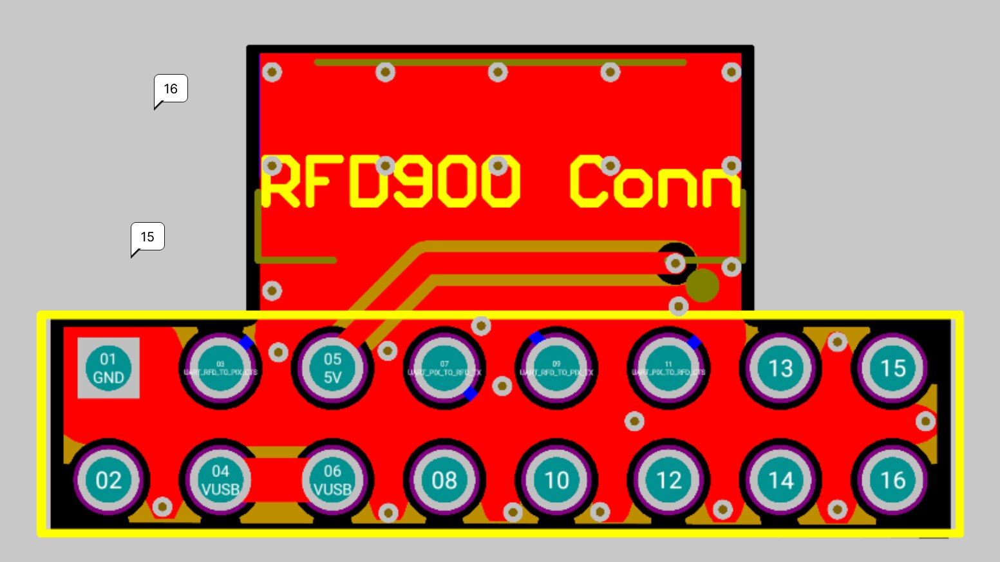
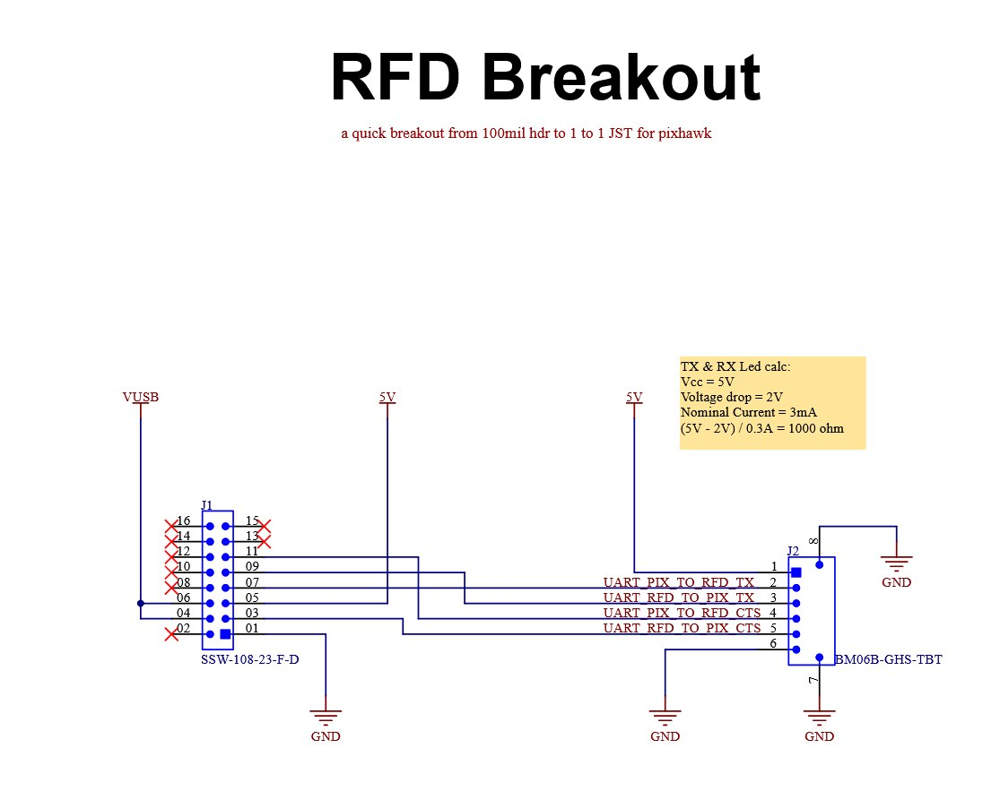

## What it is

A small breakout board for the RFD900X telemetry radio, built for the Waterloo Aerial
Robotics Team: 100mil header in, 1-to-1 JST-GH out, wired to the Pixhawk standard.

## How it was built

- Designed 4-layer GPIO-to-JST-GH breakout PCB following Pixhawk telemetry connectors standards
  to prevent reverse polarity assembly errors during flight tests.
- Assembled, tested, and conformal coated the PCBA to ensure reliable operation in outdoor/dusty
  environments.

