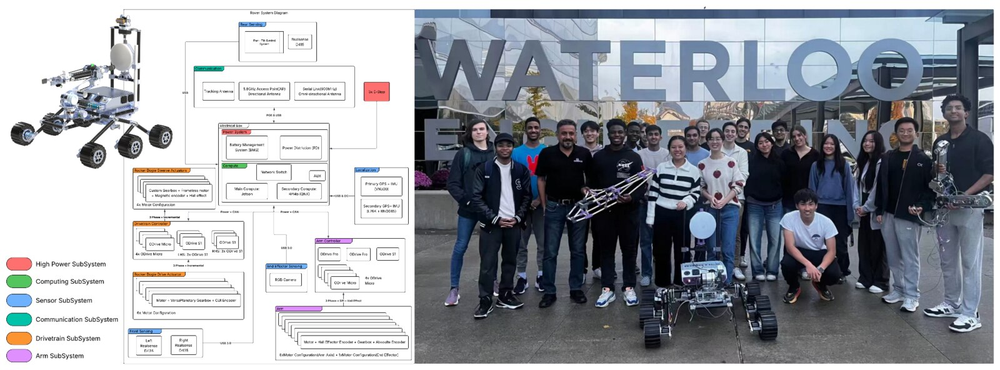

## What it is

The UWaterloo Robotics Team rover, and the team that built it.
[Watch it run](https://youtu.be/DZs-J-qTGSA?si=_qPi0YdptLnI-XOa).

## What the role involved

- Led 50+ member robotics team through two year-long development cycle, achieving 41st place
  internationally out of 108 teams in University Rover Challenge.
- Secured SimulationX technical sponsorship, enabling team access to professional kinematics
  simulation tools, validating arm controller design, and integrated results into arm controller.
- Designed power system architecture featuring efficient battery management for 2+ hour rover
  operation with state-of-charge monitoring and overvoltage/overcurrent protection.
- Documented standard operating procedures for 12s LiPo battery charging, handling, and safety
  protocols to ensure working space safety and prevent electrical hazards.
- Mentored new members in embedded systems fundamentals including firmware development, firmware
  and hardware debugging with oscilloscopes and debuggers, circuit design, and soldering through
  hands-on workshops and design reviews.
- Overseeing ~$12k per year funding proposals and expenditures in addition to ~$6k liquid team funds.
- Represented team at technical conferences and open houses, presenting rover functionalities and
  achievements to diverse audiences including students, families, and industry professionals.
