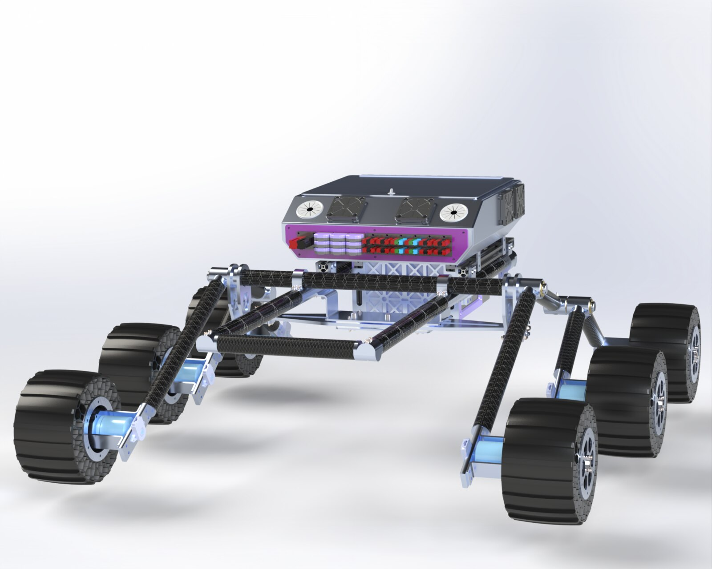
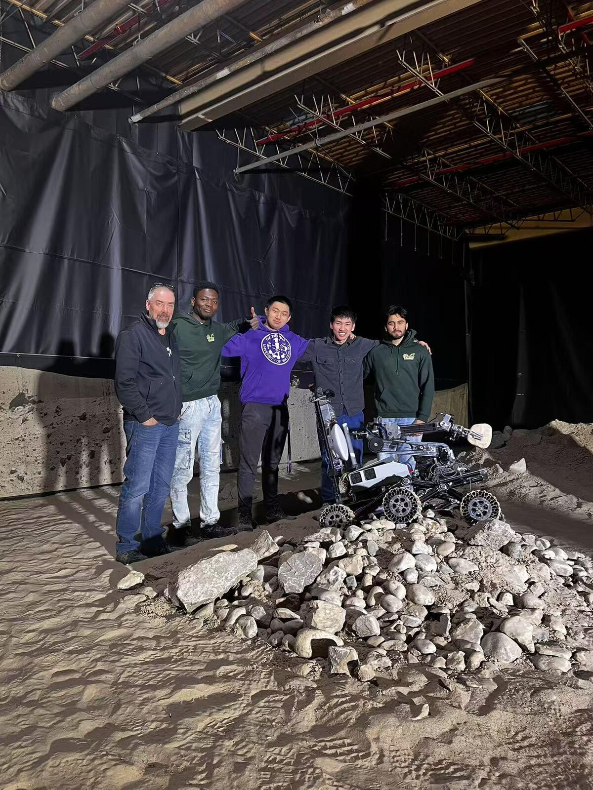

## What it is

The drivetrain for the UWaterloo Robotics Team rover - suspension kinematics, the
controllers that drive it, and the vision loop that lets it follow a target.
Source: [uwrobotics/Drivetrain](https://github.com/uwrobotics/Drivetrain).

## How it was built

- Studied rocker-bogie kinematics by investigating existing
  [matlab rover implementations](https://github.com/giusenso/rover-dynamics-and-control)
  and [simulating suspension behavior](https://github.com/chetanborse1999/Rover-Sim) in Gazebo.
- Developed forward and inverse kinematics algorithms for rocker-bogie suspension based on
  [NASA Open Source Rover](https://github.com/nasa-jpl/osr-rover-code), validated through
  terrain traversal capability on UWRT's rover.
- Built Python OpenCV application for ArUco tag detection and tracking using stereo cameras,
  enabling rover drivetrain to autonomously follow visual targets.
- Led and developed three successive rover drivetrain controllers: FreeRTOS on STM32L5,
  Python-based direct motor control on Jetson, and ROS2-control framework with custom
  kinematics implementation.

